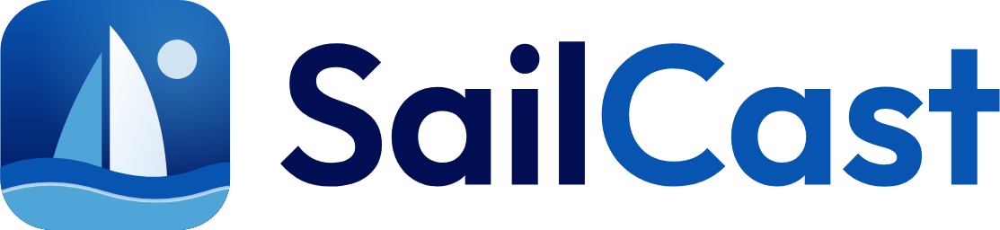

<p align="center">
  <picture>
    <source media="(prefers-color-scheme: dark)" srcset="custom_components/sailcast/brand/dark_logo.png">
    
  </picture>
</p>

SailCast is a Home Assistant integration for sailors. It turns wind, gust, wave, tide, current and weather forecasts into:

- a safety rating for every boat size, hour by hour
- a 0–100 sailing score for each sailor and boat
- the best sailing windows of the week
- plain-language advice

It adds a SailCast page to the sidebar, with a week calendar, a day view, an animated wind map and settings, plus entities and a calendar for automations.

> [!IMPORTANT]
> SailCast is advisory. Official forecasts and warnings come first, and the skipper always decides.

## Status

SailCast is in early development. Milestones 0 to 3 are done: SailCast fetches the forecast, rates every hour for every boat size, scores each sailor's boats and finds sailing windows. The sidebar panel shows the week as a calendar, each day hour by hour, an animated wind map, and the settings, and puts windows into your own calendar one at a time or automatically. Entities, a calendar and an action share the results with automations. Local accuracy (buoys, airports, your own sensors, and waves in sheltered water) comes in milestone 4. The [plan](docs/PLAN.md) describes everything SailCast will do and the order of work. The [safety limits](docs/safety-limits.md) list every number the ratings use.

## Install

SailCast needs Home Assistant 2026.11 or newer. It isn't in the Marketplace's default catalog yet. Once a release is published, add `https://github.com/kedube/ha-sailcast` as a custom repository in Marketplace, with the type **Integration**. Then install SailCast and restart Home Assistant.

## Set up

1. Go to **Settings → Devices & services → Add integration** and pick **SailCast**.
2. Open **SailCast** in the sidebar, and add your spots, boats and sailors on its **Settings** tab. SailCast's page under Devices & services edits the same settings.
   - **Spot:** a pin on the water, the kind of water, and which directions are offshore and open to waves. SailCast then suggests the nearest tide station, current station and marine warning zone. These come from NOAA and the National Weather Service, so for now they cover US waters only.
   - **Boat:** a name, a size and a length.
   - **Sailor:** their skill, their usual boat and others, and when they can sail. Optionally, what they enjoy (an ideal wind range, the coldest air they like, and how much rain they mind), and the Home Assistant user the panel opens on them for.

Only administrators can change settings. Everyone can pick their own spot, sailor and boat at the top of the panel, and SailCast remembers the choice on every device.

Each sailor rates their own skill, which sets their limit for sustained wind: up to 10 kt for Beginner, 16 kt for Intermediate, and no limit for Advanced. Gusts don't count toward it.

## The wind map

The **Wind map** tab shows the wind or the gusts around a spot as colors, with particles that follow the wind. Play through the week, jump to a day, or point at the map to read the wind there. A grid of points about 2 km apart is fetched only when you open the map and kept for three hours, and nearby spots share it. Each point counts toward Open-Meteo's free daily allowance, so SailCast stops fetching grids well before the limit and shows the last one instead.

## Your own calendar

To keep the time free, put sailing windows into a calendar of your own: any Home Assistant calendar that accepts new events, such as Local Calendar, Google Calendar or CalDAV.

- **One at a time.** Select a window in the week or day view, then **Add to calendar**. SailCast adds the event as you, so the calendar's own permissions apply. Select the window again to take it out.
- **Automatically.** Turn on automatic adding for a sailor, in Settings or from the week view. SailCast then adds that sailor's best window each chosen day, at most one a day, and keeps it in step with the forecast: it moves the event when the window shifts by 30 minutes or more and takes it out if the window goes away. From 6 PM the evening before, it leaves the event alone. A day you take an automatic event out of isn't added again.

SailCast watches every window it added. If one's forecast gets worse, it posts a notification and fires a `sailcast_planned_sail_changed` event, which an automation can turn into a phone notification. Calendars that can't change events, such as CalDAV, keep what was added; SailCast only warns.

## Entities and actions

Each spot and each sailor is a device. Ratings and scores use the sailor's skill and usual boat.

| Entity | For | Example |
| --- | --- | --- |
| Safety rating now: good, caution, not recommended or dangerous, with the reasons | each sailor at each spot | `sensor.alex_harbor_rating` |
| Sailing score now, 0–100, in daylight | each sailor at each spot | `sensor.alex_harbor_score` |
| Good to sail now, during a sailing window | each sailor at each spot | `binary_sensor.alex_harbor_good_to_sail` |
| Next sailing window, at any spot | each sailor | `sensor.alex_next_sailing_window` |
| Sailing windows in each of their boats, read-only | each sailor | `calendar.alex_sailing` |
| Official marine warning in effect | each spot with a warning zone | `binary_sensor.harbor_marine_warning` |
| Wind, gusts, waves, water temperature and the next tides | each spot, off by default | `sensor.harbor_wind` |

`sailcast.get_forecast` returns a sailor's week at a spot: each day's windows, score and model agreement, and each hour's conditions, with every boat size rated at their skill.

```yaml
action: sailcast.get_forecast
data:
  spot: Harbor
  sailor: Alex
response_variable: forecast
```

## Development

You need [uv](https://docs.astral.sh/uv/) and Node 24 or newer.

| Command | What it does |
| --- | --- |
| `scripts/setup` | Creates `.venv` with Python 3.14, Home Assistant and the test tools, installs and builds the panel, and turns on the git hooks. |
| `scripts/develop` | Starts Home Assistant from `config/` with this integration, at <http://localhost:8123>. |
| `scripts/lint` | Formats and lints the Python and TypeScript. |
| `.venv/bin/pytest` | Runs the integration's tests. |
| `npm run dev` in `frontend/` | Rebuilds the panel on save. |
| `.venv/bin/python scripts/demo_data.py` | Writes the demo's data: the integration's own replies for the recorded San Diego week. |
| `npm run demo` in `frontend/` | Serves the panel with that data. Add `?mode=night`, `?units=metric`, `?view=day`, `?admin=0` or `?empty`. |
| `npm test` in `frontend/` | Runs the panel's tests. |
| `.venv/bin/python scripts/record_fixtures.py` | Records the provider responses the tests run on. |
| `.venv/bin/python scripts/safety_limits_doc.py` | Writes [docs/safety-limits.md](docs/safety-limits.md) from the limits table. A test fails if it's out of date. |

On macOS, the python.org build of Python ships without SSL certificates. If you use it, run its "Install Certificates" command once, or Home Assistant can't reach any API.

### Privacy

The repository holds no personal data. Tests run on responses recorded at made-up spots in San Diego. The git hooks that `scripts/setup` turns on check every commit and commit message against a list of private terms kept outside the repository, in `~/.config/sailcast/private-terms.txt` or the file named by `SAILCAST_PRIVATE_TERMS`. Put one term per line, matched as a whole word. Lines starting with `re:` are regular expressions.

## Credits

- Weather and marine data: [Open-Meteo](https://open-meteo.com), under CC BY 4.0. SailCast stays within its free tier for non-commercial use.
- Tide and current predictions: [NOAA CO-OPS](https://tidesandcurrents.noaa.gov). Marine warnings: the [National Weather Service](https://www.weather.gov). Neither is for navigation.
- Maps: © [OpenStreetMap](https://www.openstreetmap.org/copyright) contributors, through Home Assistant's own map tiles, with [OpenFreeMap](https://openfreemap.org) as a fallback; seamarks from [OpenSeaMap](https://www.openseamap.org) (CC BY-SA 2.0). Drawn with [MapLibre GL JS](https://maplibre.org) (BSD-3-Clause).
- Wordmark: [Outfit](https://github.com/Outfitio/Outfit-Fonts), under the SIL Open Font License 1.1. More in [docs/brand](docs/brand/README.md).

## License

[GPL-3.0](LICENSE)
