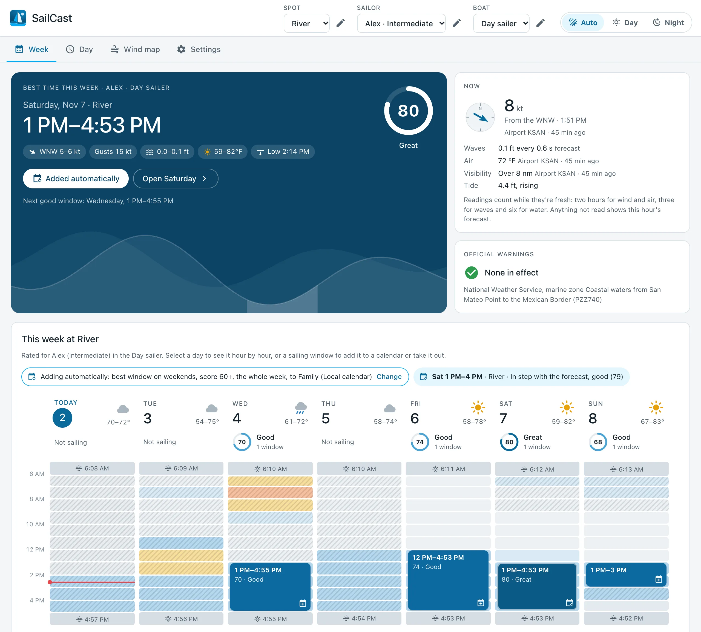
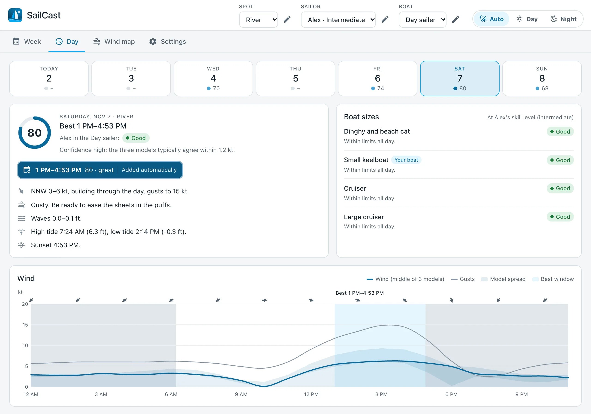
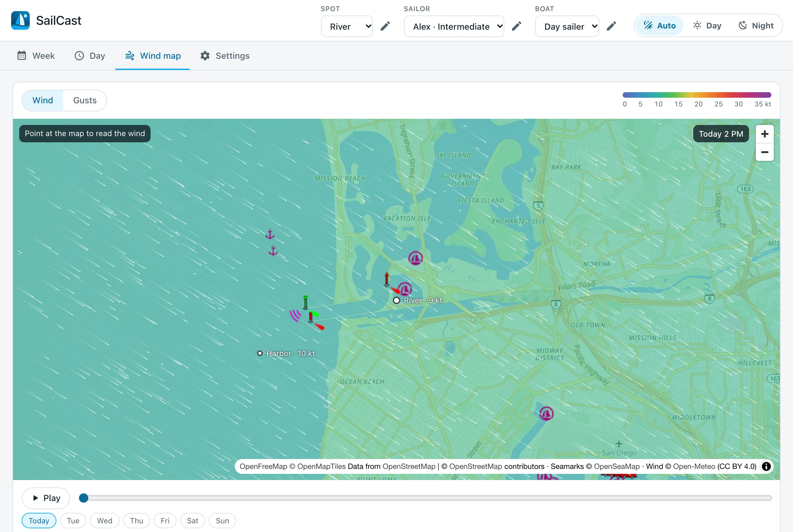
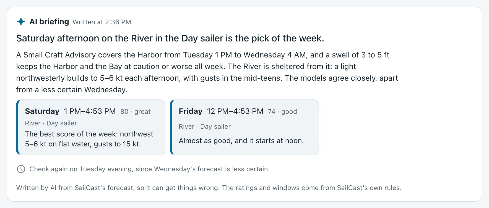

# SailCast for Home Assistant

[](https://www.hacs.xyz/docs/marketplace/)
[](https://github.com/kedube/ha-sailcast/releases)
[](https://github.com/kedube/ha-sailcast/actions/workflows/ci.yml)

[](LICENSE)

<p align="center">
  <picture>
    <source media="(prefers-color-scheme: dark)" srcset="custom_components/sailcast/brand/dark_logo.png">
    
  </picture>
</p>

SailCast is a Home Assistant integration for sailors. It turns wind, gust, wave, tide, current and weather forecasts into:

- a safety rating for every boat size, hour by hour
- a 0–100 sailing score for each sailor and boat
- the best sailing windows of the week
- plain-language advice

It adds a SailCast page to the sidebar, with a week calendar, a day view, an animated wind map and settings, plus entities and a calendar for automations.

<picture>
  <source media="(prefers-color-scheme: dark)" srcset="docs/images/week-dark.webp">
  
</picture>

> [!IMPORTANT]
> SailCast is advisory. Official forecasts and warnings come first, and the skipper always decides.

[What's in it](#whats-in-it) · [Install](#install) · [Set up](#set-up) · [Wind map](#the-wind-map) · [Outside the US](#outside-the-us) · [Calendar](#your-own-calendar) · [Notifications](#notifications) · [AI briefing and Assist](#ai-briefing-and-assist) · [Entities and actions](#entities-and-actions) · [Troubleshooting](#troubleshooting) · [Limitations](#known-limitations) · [Development](#development)

## What's in it

- **Forecasts for the water:** wind, gusts and waves anywhere, with the wind from three weather models. Official warnings in the US, Canada and Europe. Tides in the US, Canada, the Netherlands and Norway, and anywhere with a WorldTides key. Currents in the US.
- **Local corrections:** readings from buoys, airports and your own sensors nudge the next few hours, with a buoy's wind scaled from its anemometer to the 10 m forecasts use, and waves on rivers and lakes are worked out from the open water measured on the map.
- **A sidebar panel:** the week as a calendar, each day hour by hour, an animated wind map, and the settings.
- **Your own calendar:** sailing windows go into it one at a time or automatically, and SailCast warns you when a planned sail's forecast gets worse.
- **Automations:** entities, a calendar, an action, and two blueprints for phone notifications.
- **AI, if you want it:** a briefing of your week from the AI provider you use in Home Assistant, and answers to sailing questions through Assist. The ratings always come from SailCast's own rules.
- **12 languages.**

<picture>
  <source media="(prefers-color-scheme: dark)" srcset="docs/images/day-dark.webp">
  
</picture>

The [safety limits](docs/safety-limits.md) list every number the ratings use, and the [plan](docs/PLAN.md) explains the choices behind them.

## Status

Please [report problems](https://github.com/kedube/ha-sailcast/issues), above all a rating that doesn't match the conditions you saw.

## Install

SailCast needs Home Assistant 2026.11 or newer, and installs through the Marketplace.

[](https://my.home-assistant.io/redirect/marketplace_repository/?owner=kedube&repository=ha-sailcast&category=integration)

1. Select the button above to add SailCast to your Marketplace as a custom repository. Or go to **Settings → Marketplace** and add `https://github.com/kedube/ha-sailcast` yourself, as an **Integration**. SailCast isn't in the Marketplace's catalog yet, and adding a repository from outside it needs the Marketplace connected to GitHub.
2. Install SailCast. You can set it up right away, without a restart.

New versions show up under **Settings → Updates**, with their release notes. After an update, restart Home Assistant when **Settings → Repairs** asks you to.

## Set up

[](https://my.home-assistant.io/redirect/config_flow_start/?domain=sailcast)

1. Select the button above, or go to **Settings → Devices & services → Add integration** and pick **SailCast**. It asks for nothing, and shows a safety note.
2. Open **SailCast** in the sidebar, and add your spots, boats and sailors on its **Settings** tab. SailCast's page under Devices & services edits the same settings.
   - **Spot:** a pin on the water, the kind of water, and which directions are offshore and open to waves. SailCast then suggests the nearest tide station, current station, source of official warnings, buoy and airport; see [outside the US](#outside-the-us) for what each country has. You can add your own sensors too, such as a weather station on the dock.
   - **Boat:** a name, a size, a length, and whether it has navigation lights. With lights, hours after dark count too, so its windows can start before sunrise and run past sunset, and the week calendar shows the whole day instead of just daylight.
   - **Sailor:** their skill, their usual boat and others, and the days they sail, each with its own hours, such as 5 PM on weekdays and sunrise at weekends. Optionally, what they enjoy (an ideal wind range, the coldest air they like, and how much rain they mind), and the Home Assistant user the panel opens on them for.

Only administrators can change settings. Everyone can pick their own spot, sailor and boat at the top of the panel, and SailCast remembers the choice on every device. For a day off, or a day you can't sail, change that one date's hours under the day in the week view; administrators can do it for any sailor, and others for the sailor linked to them.

Each sailor rates their own skill, which sets their limit for sustained wind: up to 10 kt for Beginner, 16 kt for Intermediate, and no limit for Advanced. Gusts don't count toward it.

[docs/settings.md](docs/settings.md) describes every setting and option, with its default.

## The wind map

The **Wind map** tab shows the wind or the gusts as colors, with particles that follow the wind. It opens on the spot's wind map area, and when you pan or zoom, the wind follows. Play through the week, jump to a day, or point at the map to read the wind there.

<picture>
  <source media="(prefers-color-scheme: dark)" srcset="docs/images/map-dark.webp">
  
</picture>

The wind comes as a grid of at most 15 × 15 points: about 2 km apart up close, and further apart as you zoom out. A grid is fetched only for what the map shows, kept for three hours, and used again whenever it covers the view, and nearby spots share one. Each point counts toward Open-Meteo's free allowance of 600 calls a minute, 5,000 an hour and 10,000 a day. So SailCast waits a moment when grids come too quickly, stops fetching them well before the daily limit, and shows the wind it already has instead.

## Readings and waves

When a buoy, an airport or your own sensor has a fresh reading, SailCast compares it with the forecast for the same place and moves the spot's next few hours by the difference, fading out over six hours. The week view shows what's read now, with who read it and how long ago. A visibility measured nearby can make the hour under way dangerous; a forecast one never does.

When you add a spot, SailCast measures how far open water reaches each way from the pin, on OpenStreetMap's map. Rivers and lakes get waves worked out from the wind and that open water upwind. On open water, ocean model waves from a direction the spot is sheltered from are reduced. If the pin is on land, a buoy, airport, sensor or tide station stops reporting, or WorldTides' key is missing or refused, SailCast says so under **Settings → Repairs**.

## Outside the US

The forecast, waves and airport reports work anywhere. Tides and official warnings come from each country's own services:

| Where | Tides | Official warnings |
| --- | --- | --- |
| US | NOAA's stations | The National Weather Service's marine zones, or its alerts for the pin on a lake, such as a Lake Wind Advisory |
| Canada | The Canadian Hydrographic Service's stations | Environment and Climate Change Canada's marine areas, whole or in part, such as Western Lake Ontario |
| Netherlands | Rijkswaterstaat's stations, above NAP | MeteoAlarm, from KNMI, including its warnings for the coastal waters and the IJsselmeer |
| Norway | Kartverket, worked out for the pin | MeteoAlarm, from MET Norway |
| Rest of Europe | With a WorldTides key | MeteoAlarm, from each country's weather service |
| Anywhere else | With a WorldTides key | None yet |

- **WorldTides** has tides almost anywhere, from a tide gauge near the pin or its global model. It needs your own key from [worldtides.info](https://www.worldtides.info): add it under **Settings → Devices & services → SailCast → Configure**. New accounts get 100 credits for a month, then a key costs $3.99 a year for 1,000 credits. A spot uses about 3 credits every five days.
- **The ocean model's tide** is there for any spot with nothing better, as a rough curve without highs and lows. Near the coast its times can be an hour or more off, so it's never picked for you, and SailCast doesn't use it for times or advice.
- **MeteoAlarm** warnings follow the regions within a few kilometers of the pin, so a lake shared by regions gets each one's warnings. Their outlines come from the file MeteoAlarm publishes for those who pass its warnings on. It isn't openly licensed, so SailCast doesn't include it: Home Assistant downloads it (about 33 MB) the first time a spot in Europe needs it, keeps a 1 MB copy, and looks for a newer one each month.
- **Canada's marine warnings** don't say when they end, so SailCast counts one from when it's issued to the end of the next day, or until it's lifted.
- **The UK's strong wind and gale warnings** for coastal waters have no open feed, so UK spots get the Met Office's warnings for land and coast through MeteoAlarm, and SailCast's own wind limits.

Times show in Home Assistant's time zone, so a spot in another time zone shows its hours in yours.

## Your own calendar

To keep the time free, put sailing windows into a calendar of your own: any Home Assistant calendar that accepts new events, such as Local Calendar, Google Calendar or CalDAV.

- **One at a time.** Select a window in the week or day view, then **Add to calendar**. SailCast adds the event as you, so the calendar's own permissions apply. Select the window again to take it out.
- **Automatically.** Turn on automatic adding for a sailor, in Settings or from the week view. SailCast then adds that sailor's best window each chosen day, at most one a day, and keeps it in step with the forecast: it moves the event when the window shifts by 30 minutes or more and takes it out if the window goes away. From 6 PM the evening before, it leaves the event alone. A day you take an automatic event out of isn't added again.

SailCast watches every window it added. If one's forecast gets worse, it posts a notification and fires a `sailcast_planned_sail_changed` event, which an automation can turn into a phone notification. Calendars that can't change events, such as CalDAV, keep what was added; SailCast only warns.

Events and notifications are written in Home Assistant's language. An event you add from the panel is written in yours.

## Notifications

Two blueprints send SailCast's news to your phone through the Home Assistant app. Import one, then create an automation from it under **Settings → Automations & scenes → Blueprints**.

| Blueprint | What it sends | Import |
| --- | --- | --- |
| Tomorrow's sailing windows | The evening before, at a time you pick, each of a sailor's windows for the next day, with its times, score and wind. | [](https://my.home-assistant.io/redirect/blueprint_import/?blueprint_url=https%3A%2F%2Fgithub.com%2Fkedube%2Fha-sailcast%2Fblob%2Fmain%2Fblueprints%2Fautomation%2Fsailcast%2Fwindows_tomorrow.yaml) |
| A planned sail got worse | SailCast's message when a window in your calendar no longer looks good, for every sailor or one. | [](https://my.home-assistant.io/redirect/blueprint_import/?blueprint_url=https%3A%2F%2Fgithub.com%2Fkedube%2Fha-sailcast%2Fblob%2Fmain%2Fblueprints%2Fautomation%2Fsailcast%2Fplanned_sail_changed.yaml) |

The messages are SailCast's own, in Home Assistant's language; the titles are yours to change. For automations of your own, the `sailcast_planned_sail_changed` event has `sailor`, `spot`, `boat`, `start`, `end`, `calendar`, `title`, `rating`, `score`, `automatic` and `message`. Each event in a sailor's SailCast calendar starts with a line for its window, such as "1 PM to 4:53 PM, score 80 (great). NW 5 to 6 kt, gusts to 15 kt."

## AI briefing and Assist

SailCast can use the AI provider you've set up in Home Assistant, such as OpenAI, Google Gemini, Anthropic or Ollama, in two ways. Both are optional, and SailCast stores no AI keys. The safety ratings and sailing windows always come from SailCast's own rules: AI explains and compares them, and never sets or softens one.

### The briefing

Turn it on under **Settings → Devices & services → SailCast → Configure**, where you can also pick which AI task writes it. Leave that empty to use Home Assistant's default, set under **Settings → System → AI**.

The week view then opens with a briefing for the sailor you picked: a headline, a few sentences that compare the days, spots and boats, up to three picks, and when to check again. It says how the wind and waves change, names official warnings first, and says where the weather models disagree. Each pick is one of SailCast's own windows, shown with SailCast's times and score, and selecting it opens that day. The day view shows the briefing's note for the day.

<picture>
  <source media="(prefers-color-scheme: dark)" srcset="docs/images/briefing-dark.webp">
  
</picture>

SailCast writes a briefing when you open the panel or pick another sailor, if the forecast has changed since the last one. It keeps it, through restarts, until the ratings, windows or warnings it describes change. An open panel never asks the AI by itself: it says when the forecast has changed, and **Update the briefing** writes a new one.

Each briefing sends your AI provider the coming week at every spot in each of the sailor's boats, in your units, with the names of the sailor, boats and spots and the spots' notes, and nothing else. For three spots and two boats that's about 5,000 tokens, so with a paid provider each briefing costs a little.

### Notes for the AI

Each spot has **Notes for the AI**, in the panel's spot dialog and the spot's settings: up to 500 characters of local knowledge, such as when the sea breeze fills in or where it gets rough. The briefing and Assist use them to explain the conditions. They never change a rating.

### Ask Assist

SailCast also gives Assist tools to read its forecast, so you can ask "When's the best time to sail this weekend?" or "Is Saturday afternoon good for the keelboat at the harbor?". To turn them on, open your AI provider under **Settings → Devices & services**, change the settings of its conversation agent, and under **AI tools** select **SailCast**.

Answers are for the person asking: the sailor linked to their Home Assistant user, or the one they picked in the panel. Ask about another sailor by name. The tools only read the forecast; they can't change settings or calendars. A question sends your AI provider what it needs to answer: the forecast for that sailor, and the names of the sailors, boats and spots.

## Languages

SailCast is in English, German, French, Dutch, Spanish, Simplified Chinese, Italian, Polish, Swedish, Russian, Czech and Brazilian Portuguese. SailCast's dialogs and its panel are in each person's own language, and calendar events and notifications in Home Assistant's.

The 11 translations were written by AI and haven't been checked by native speakers yet. If you sail and speak one of them, corrections are welcome, above all for the safety wording. [docs/translations.md](docs/translations.md) says where the strings are and has a glossary of the terms each language uses.

## Entities and actions

Each spot and each sailor is a device. Ratings and scores use the sailor's skill and usual boat.

| Entity | For | Example |
| --- | --- | --- |
| Safety rating now: good, caution, not recommended or dangerous, with the reasons | each sailor at each spot | `sensor.alex_harbor_rating` |
| Sailing score now, 0–100, in daylight, or at any hour if the usual boat has navigation lights | each sailor at each spot | `sensor.alex_harbor_score` |
| Good to sail now, during a sailing window | each sailor at each spot | `binary_sensor.alex_harbor_good_to_sail` |
| Next sailing window, at any spot | each sailor | `sensor.alex_next_sailing_window` |
| Sailing windows in each of their boats, read-only | each sailor | `calendar.alex_sailing` |
| Official marine warning in effect | each spot with a warning zone | `binary_sensor.harbor_marine_warning` |
| Wind, gusts, waves, water temperature and the next tides | each spot, off by default | `sensor.harbor_wind` |

`sailcast.get_forecast` returns a sailor's week at a spot: each day's windows, score and model agreement, and each hour's conditions, with every boat size rated at their skill.

```yaml
action: sailcast.get_forecast
data:
  spot: Harbor
  sailor: Alex
response_variable: forecast
```

Add `boat` to rate one of the sailor's other boats. An unknown spot, sailor or boat gives an error that names it.

## How often it updates

| What | How often |
| --- | --- |
| Forecast from three weather models | Every hour, or every 3 hours once Open-Meteo's free calls for the day run low |
| Model agreement | Every 6 hours |
| Waves | Every 3 hours |
| Official warnings | Every 5 minutes |
| Tide and current predictions | Once a day for each station; WorldTides about every five days |
| Buoy readings | Every 20 minutes |
| Airport reports | Every 30 minutes |
| Your own sensors | Whenever the ratings are worked out, and live in the panel |
| The wind map's grids | When you open or move the map, kept for 3 hours |

Ratings, scores and windows are worked out again whenever new data comes in, and at the start of every hour.

## Troubleshooting

- **Settings → Repairs** lists what SailCast found wrong, and how to fix it: a pin on land, a buoy, airport, sensor or station that stopped reporting, Open-Meteo's free calls running low, and a missing or refused WorldTides key.
- **Diagnostics** show each source's status and last error, and the Open-Meteo calls used today. Download them from SailCast's menu under **Settings → Devices & services → SailCast**. They leave out where your spots are, every name, station and warning zone, your sensors and calendars, and your API key, so you can attach them to an issue.
- **Debug logging** records what SailCast fetches and when. Turn it on from the same menu, try again, then turn it off to download the log.

[Open an issue](https://github.com/kedube/ha-sailcast/issues) with the diagnostics and what you expected to see.

## Known limitations

- SailCast is advisory. Its tides, currents and warnings aren't for navigation.
- Times show in Home Assistant's time zone, also for a spot in another one.
- Outside the US, Canada and Europe there are no official warnings yet, and the UK's coastal strong wind and gale warnings have no open feed.
- The 11 translations haven't been checked by native speakers.
- Open-Meteo's free tier is for non-commercial use, and its daily limit is shared with everything else on your IP address.

## Remove SailCast

1. Go to **Settings → Devices & services → SailCast**, open its menu, and select **Delete**. That removes its entities, calendars and panel, and what it saved: panel preferences, planned sails, measured shorelines, tide predictions, warning regions and AI briefings.
2. To remove its program files too, uninstall SailCast in **Settings → Marketplace**, then restart Home Assistant.

Events SailCast added to your own calendars stay there, and automations made from its blueprints stop working. Delete them yourself if you don't want them.

## Development

You need [uv](https://docs.astral.sh/uv/) and Node 24 or newer.

| Command | What it does |
| --- | --- |
| `scripts/setup` | Creates `.venv` with Python 3.14, Home Assistant and the test tools, installs and builds the panel, and turns on the git hooks. |
| `scripts/develop` | Starts Home Assistant from `config/` with this integration, at <http://localhost:8123>. |
| `scripts/lint` | Formats and lints the Python and TypeScript. |
| `.venv/bin/pytest` | Runs the integration's tests. |
| `npm run dev` in `frontend/` | Rebuilds the panel on save. |
| `.venv/bin/python scripts/demo_data.py` | Writes the demo's data: the integration's own replies for the recorded San Diego week. |
| `npm run demo` in `frontend/` | Serves the panel with that data. Add `?mode=night`, `?units=metric`, `?view=day`, `?admin=0`, `?empty`, `?lang=de` or `?ai`, and `?ai=slow`, `?ai=stale` or `?ai=fail` for the briefing while it's written, out of date or failed. |
| `npm test` in `frontend/` | Runs the panel's tests. |
| `.venv/bin/python scripts/screenshots.py` | Takes this README's screenshots of the demo, in light and dark, into [docs/images](docs/images). The demo and a headless Chrome have to be running; the script's notes say how. |
| `.venv/bin/python scripts/record_fixtures.py` | Records the provider responses the tests run on. |
| `.venv/bin/python scripts/safety_limits_doc.py` | Writes [docs/safety-limits.md](docs/safety-limits.md) from the limits table. A test fails if it's out of date. |

On macOS, the python.org build of Python ships without SSL certificates. If you use it, run its "Install Certificates" command once, or Home Assistant can't reach any API.

### Releasing

Releases are made by hand: on GitHub, open **Actions → Release → Run workflow** and run it on `main`. Once CI passes, the workflow works out the version from the last release. Stable versions have two digits after the point:

| Last release | stable | beta |
| --- | --- | --- |
| 1.0.0b4 | 1.00 | 1.0.0b5 |
| 1.00 | 1.01 | none |
| 1.99 | 2.00 | none |

Home Assistant won't load an integration whose version is like 1.01b1, so there are no betas after 1.00. The workflow saves the version in `manifest.json` and commits it to `main`, unless `main` already has it. Then it builds the panel and publishes a GitHub release tagged with the bare version, such as `1.00`, with `sailcast.zip` for the Marketplace to install. Betas are pre-releases. The release notes list the commits since the last stable release, or since the last release for a beta. Notes written in `.github/release-notes/<version>.md`, such as `1.00.md`, are used instead. To see the next version first, run `.venv/bin/python scripts/bump_version.py stable`, or `beta`.

### Privacy

The repository holds no personal data. Tests run on responses recorded at made-up spots in San Diego, and in the Solent, the Wadden Sea and on Lake Garda for sources abroad. Canada's tide predictions and MeteoAlarm's region outlines can't be passed on, and WorldTides needs a key, so their tests use made-up data. The git hooks that `scripts/setup` turns on check every commit and commit message against a list of private terms kept outside the repository, in `~/.config/sailcast/private-terms.txt` or the file named by `SAILCAST_PRIVATE_TERMS`. Put one term per line, matched as a whole word. Lines starting with `re:` are regular expressions.

## Credits

- Weather and marine data: [Open-Meteo](https://open-meteo.com), under CC BY 4.0. SailCast stays within its free tier for non-commercial use.
- Tide and current predictions: [NOAA CO-OPS](https://tidesandcurrents.noaa.gov). Marine warnings: the [National Weather Service](https://www.weather.gov). Neither is for navigation.
- Canadian tides: the [Canadian Hydrographic Service](https://www.tides.gc.ca), under its [licence](https://www.tides.gc.ca/en/licence-agreement); the panel shows its notice with them. Canadian marine warnings: Data Source: [Environment and Climate Change Canada](https://eccc-msc.github.io/open-data/licence/readme_en/).
- Dutch tides: [Rijkswaterstaat](https://rijkswaterstaatdata.nl/waterdata/) (CC0). Norwegian tides: ©[Kartverket](https://www.kartverket.no/en/api-and-data/terms-of-use) (CC BY 4.0). Tides with your own key: [WorldTides](https://www.worldtides.info/copyright). The ocean model's sea level: Open-Meteo, with E.U. Copernicus Marine Service information.
- European warnings: [MeteoAlarm](https://meteoalarm.org) (EUMETNET), from each country's national weather service, under terms equivalent to CC BY 4.0. None of these is for navigation.
- Buoy readings: NOAA's [National Data Buoy Center](https://www.ndbc.noaa.gov). Airport reports: the [Aviation Weather Center](https://aviationweather.gov).
- Maps: © [OpenStreetMap](https://www.openstreetmap.org/copyright) contributors, through Home Assistant's own map tiles, with [OpenFreeMap](https://openfreemap.org) as a fallback; seamarks from [OpenSeaMap](https://www.openseamap.org) (CC BY-SA 2.0). Drawn with [MapLibre GL JS](https://maplibre.org) (BSD-3-Clause). The shoreline that fetch is measured on is OpenStreetMap's water, from [OpenFreeMap](https://openfreemap.org)'s tiles (© OpenMapTiles).
- The panel bundles [Lit](https://lit.dev) (BSD-3-Clause), MapLibre GL JS and [Material Design Icons](https://pictogrammers.com/library/mdi/) (Apache-2.0 icons, MIT code). Their license notices ship with it, in `custom_components/sailcast/frontend/THIRD_PARTY_LICENSES.md`.
- Wordmark: [Outfit](https://github.com/Outfitio/Outfit-Fonts), under the SIL Open Font License 1.1. More in [docs/brand](docs/brand/README.md).

## License

[GPL-3.0](LICENSE)
