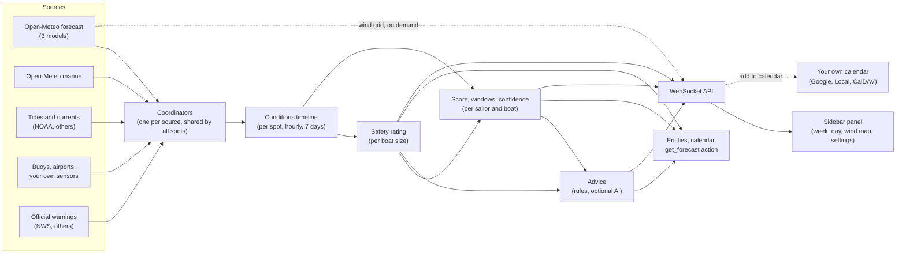

# SailCast plan

Approved November 2, 2026 · Maintainer: [@kedube](https://github.com/kedube)

A private panel mockup, built from a real week of forecast data for the test spots, shows the design. It stays private because it contains real location data.

SailCast is a Home Assistant integration that turns wind, gust, wave, tide, current and weather forecasts into four things:

- a safety rating for every boat size, hour by hour
- a 0–100 sailing score for each sailor and boat
- the best sailing windows of the week
- plain-language advice

It adds a SailCast page to the Home Assistant sidebar with a calendar-style week view, a day view, an animated wind map and a settings tab. It also creates entities and a calendar so automations can use the results. It works anywhere in the world, with extra free data in some countries, and it's distributed through the Home Assistant Marketplace.

This is the plan SailCast is built from. The [milestones](#15-milestones) section lists the order of work, and the [review history](#17-review-history) records when each decision was made.

## Contents

1. [Decisions so far](#1-decisions-so-far)
2. [What the test data showed](#2-what-the-test-data-showed)
3. [How it fits together](#3-how-it-fits-together)
4. [Configuration](#4-configuration)
5. [Data sources](#5-data-sources)
6. [Conditions timeline and local corrections](#6-conditions-timeline-and-local-corrections)
7. [Safety rating](#7-safety-rating)
8. [Score, sailing windows and confidence](#8-score-sailing-windows-and-confidence)
9. [Advice and the AI option](#9-advice-and-the-ai-option)
10. [Entities, calendar and actions](#10-entities-calendar-and-actions)
11. [The sidebar panel](#11-the-sidebar-panel)
12. [The wind map](#12-the-wind-map)
13. [Languages](#13-languages)
14. [Quality, testing and distribution](#14-quality-testing-and-distribution)
15. [Milestones](#15-milestones)
16. [Risks](#16-risks)
17. [Review history](#17-review-history)
18. [Sources](#18-sources)

## 1. Decisions so far

| Topic | Decision |
| --- | --- |
| Where | Anywhere in the world: ocean coasts, bays and estuaries, lakes. Development uses three test spots on the US East Coast: a tidal river, an open bay, and a harbor open to the ocean. |
| Spots | Several per installation. |
| Boat sizes | Dinghy and beach cat (up to about 16 ft), small keelboat (16–25 ft), cruiser (25–35 ft), large cruiser (35 ft and up). |
| Safety rating | Good, caution, not recommended or dangerous, for every boat size and every hour. |
| Skill | Each sailor rates their own skill, which sets their limit for sustained wind. Beginner: up to 10 kt. Intermediate: up to 16 kt. Advanced: no wind limit, just guidance on the conditions. Gusts don't count toward the limit. Skill never loosens "dangerous", official warnings or thunderstorm rules. |
| Water temperature | Shown with each day and in the advice. It doesn't change the rating, and SailCast doesn't recommend wetsuits or drysuits. |
| Households | Several boats and sailors. Each Home Assistant user picks their own default. |
| Test boats | A 20 ft small keelboat and a 34 ft cruiser. |
| When to sail | Daylight by default. Each sailor sets the days and hours they can go. |
| Units | Wind in knots. Everything else follows Home Assistant's unit system. |
| Data | Free sources are the baseline and API keys are optional. Nearby buoys and weather stations are used when available. |
| Confidence | Compare three forecast models and show how closely they agree. |
| Advice | Written by rules. An optional AI summary uses the AI provider already set up in Home Assistant. |
| Panel | A sidebar panel only, with no dashboard card for now. Its week view is a calendar, its Settings tab edits sailors, boats and spots, and it has day and night themes. Its layout borrows from Windy and PredictWind. |
| Look | Follows the Home Assistant theme and its light and dark modes, like the rest of Home Assistant. Deep sea blue marks sailing windows, and safety ratings keep their green, amber, orange and red. |
| Calendar | Each sailor's windows show in a read-only SailCast calendar in Home Assistant. You can also add or remove single windows in a calendar of your own, such as Google Calendar, or have SailCast add each day's best window automatically on the days you pick. SailCast warns you if a planned sail's forecast gets worse. |
| Map | OpenStreetMap base map with the OpenSeaMap seamark overlay, and animated wind like Windy. |
| Languages | English plus the 11 languages with the most Home Assistant installs (see [Languages](#13-languages)). |
| Platform | Home Assistant 2026.11 or newer, installed through the Marketplace. Not aiming for Home Assistant core. |
| Name | SailCast, domain `sailcast`, licensed GPL-3.0. |
| Privacy | The public repo holds no personal data: tests run on data recorded at made-up spots in San Diego, boats are described only by size, and commits use a GitHub noreply address. See [privacy](#privacy). |

## 2. What the test data showed

I pulled one real week of data (November 1–7, 2026) for the three test spots. That data drives the mockup, and it changed this plan in several places. Place names and station IDs are left out on purpose; see [privacy](#privacy).

1. **The ocean wave model is too coarse near the coast.** Open-Meteo returned the same 8 km wave cell for the river and bay spots. Both wave cells we got are centered on land or right at the shoreline. Model waves alone can't tell the three spots apart, so SailCast needs exposure directions for each spot, local wave estimates for sheltered water, and buoy readings.
2. **Free US tide data is excellent.** NOAA has harmonic tide predictions for three stations within 2–7 km of the spots.
3. **Tidal currents need interpolation.** The two nearest current stations are subordinate stations, so NOAA only gives the times and speeds of slack water and peak flood or ebb. Asking for hourly values returns the same events. SailCast has to fill in the hours between them. One of them peaks around 3 kn.
4. **Wind against current matters on the river.** Saturday's northeasterly blows against the ebb at the river mouth in the early afternoon, which steepens the chop. The rules have to know which way each current station floods and ebbs.
5. **Buoys report patchily.** At 2 PM on November 1, the nearest offshore buoy had these latest readings:
   - water temperature from 1:30 PM
   - wind from noon
   - waves from 11 AM
   - wave direction never, in 45 days of data

   Each reading has to keep its own timestamp and expire on its own.
6. **Official warnings need a pin on the water.** The National Weather Service matched a point in the water near the spots to its marine zone, but a point on land a few hundred meters away matched no marine zone at all.
7. **Forecast agreement varies a lot.** The three models' wind forecasts agreed within about 3 kt on calm days but differed by up to 13 kt in some hours at the harbor spot. That spread is the confidence signal.
8. **November daylight is short.** Sunset was about 4:30 PM, which cuts most weekday evenings.
9. **Shoreline data is heavy.** Pulling the OpenStreetMap coastline around the test spots took 38 seconds and 3 MB. Working out exposure and fetch from map data has to happen once, when a spot is added, never on every refresh.

## 3. How it fits together



The design rules:

- **The safety rating and the score are pure Python functions** over a normalized hourly timeline, with no I/O. They get the most tests, and the panel never recomputes them.
- **Every data source sits behind a small provider interface**, so adding a country's tide or warning service doesn't touch the rating code.
- **Fetching is shared.** One forecast request covers all spots, tide predictions are fetched once a day and cached on disk, and the wind grid is fetched only when someone opens the map.
- **The panel asks for computed results over the WebSocket API.** It doesn't scrape entity states.

### Repository layout

```text
ha-sailcast/
├── custom_components/sailcast/
│   ├── __init__.py            # setup, unload, panel and WebSocket registration
│   ├── manifest.json
│   ├── config_flow.py         # main entry plus spot, boat and sailor subentries
│   ├── profiles.py            # spot, boat and sailor schemas and checks, shared by setup and the panel
│   ├── sources.py             # nearest tide station, current station and marine zone for a spot
│   ├── coordinator.py         # one coordinator per source, and one for the results
│   ├── providers/             # open_meteo, noaa_coops, ndbc, nws, metar, ha_entity, keyed tide providers
│   ├── timeline.py            # the normalized hourly conditions model
│   ├── limits.py              # the safety limits table (versioned)
│   ├── rating.py              # safety rating rules
│   ├── scoring.py             # score, windows, confidence
│   ├── outlook.py             # ratings, scores and windows for each sailor at each spot
│   ├── summary.py             # a day's or a window's conditions in a few numbers
│   ├── advice.py              # rule-based advice as translation keys
│   ├── week.py                # the week the panel shows, from now on
│   ├── planner.py             # windows in your own calendars: added, moved, watched
│   ├── wind.py                # the wind map's grid, shared by nearby spots, within the budget
│   ├── services.py            # the get_forecast action
│   ├── ai.py                  # optional AI summary through AI Task
│   ├── sensor.py, binary_sensor.py, calendar.py
│   ├── websocket_api.py       # panel commands, settings, planned sails and subscriptions
│   ├── storage.py             # per-user preferences, planned sails and skipped days
│   ├── diagnostics.py, repairs.py
│   ├── translations/          # en.json plus 11 languages
│   ├── icons.json
│   ├── brand/                 # icon, logo, dark and @2x variants
│   └── frontend/              # built panel bundle (produced by CI, not committed)
├── frontend/                  # panel source: TypeScript, Lit, Vite
├── tests/                     # pytest, with responses recorded at made-up San Diego spots
├── blueprints/automation/sailcast/
├── scripts/                   # setup, develop, lint, fixture recorder, privacy hook
├── docs/
├── hacs.json
└── .github/workflows/
```

## 4. Configuration

Everything is set up in the Home Assistant UI under **Settings → Devices & services → SailCast**, or in the SailCast panel's **Settings** tab, which edits the same configuration. There's one SailCast entry with three kinds of subentries. Subentries are Home Assistant's way of letting one integration hold several related configurations, each added and edited separately.

| Subentry | What you set |
| --- | --- |
| **Spot** | A name. A pin on the water, with a radius that sets the wind map's area. The water type: open coast, bay, estuary or river, or lake. Which wind directions blow offshore. Which directions are exposed to waves. For sheltered water and lakes, the open-water distance upwind. Optionally, the lowest tide you can launch at. The data sources: tide station, current station, buoy, airport or your own sensors, and warning zone. SailCast suggests the nearest of each, and you can change them. |
| **Boat** | A name, a size class and a length. Custom limits can come later, stricter only. |
| **Sailor** | A name. Skill, which the sailor chooses: Beginner, Intermediate or Advanced. The boats they sail, the first being their default. When they can sail (days and hours, daylight only by default). Comfort preferences: ideal wind range, lowest air temperature and rain tolerance. Automatic calendar adding: off, or on with a calendar, days, lowest score, how far ahead and spots. Optionally, a linked Home Assistant user. |

The main entry's options hold the API keys for optional providers, the AI summary setting, and refresh preferences. Setup ends with a short safety note: SailCast is advisory, official forecasts and warnings come first, and the skipper decides.

### Editing in the panel

The panel's Settings tab lists the sailors, boats and spots and edits them in place. The mockup's Settings tab shows the layout.

- **Sailors:** name, skill, boats and default boat, sailing days and hours, and linked Home Assistant user. Automatic calendar adding has its own dialog, reached from Settings or the week view.
- **Boats:** name, size and length. Each boat shows its size's limits as a scale, so you can see where caution and dangerous start.
- **Spots:** a pin on a map, the wind map's radius, name, water type and data sources. To add a spot, you select the water to drop the pin, and SailCast suggests the nearest tide, current and buoy stations, with their distances. You can drag the pin later.

The pencil next to each picker in the toolbar opens that spot, sailor or boat, so you don't have to go through Settings.
- **API keys** stay in Home Assistant's own options dialog and never reach the panel.

How it works:

- The panel reads the settings with `sailcast/config` and changes them with `sailcast/settings/save` and `delete`. These check the input with the same checks as the setup dialogs (`profiles.py`), then save it with `hass.config_entries.async_add_subentry`, `async_update_subentry` or `async_remove_subentry`. Settings → Devices & services always shows the same data. `sailcast/settings/sources` looks up the stations and zones near a pin as it moves.
- Only administrators can change settings: the commands use `@websocket_api.require_admin`, like Home Assistant's own settings pages. Other users see the Settings tab read-only. They can still pick their own sailor and boat, which are stored as per-user preferences.
- A change reloads the SailCast entry through its update listener, so ratings and entities follow straight away.

Home Assistant specifics, checked against the 2026.11 beta:

- The config flow returns `{"spot": …, "boat": …, "sailor": …}` from `async_get_supported_subentry_types`. Each subentry flow has a `user` step and a `reconfigure` step, so all three can be edited later.
- The pin uses `LocationSelector` with `radius=True`, which draws on Home Assistant's new map as of 2026.10.
- The fetch field shows only for sheltered water and lakes, using the conditional fields added in 2026.11.
- Validation uses Probatio. Home Assistant replaced voluptuous with Probatio in 2026.9; the `vol` alias still works, but new code should use Probatio directly.
- Every form passes a `step_id`. Leaving it out is deprecated in 2026.11 and breaks in 2027.5.

## 5. Data sources

The free sources work everywhere. Regional free sources and optional keyed providers add accuracy where they exist. Everything in this section was checked against the live services on November 1, 2026.

### Worldwide, free, no key

| Data | Source | Notes |
| --- | --- | --- |
| Wind, gusts and weather from three models | Open-Meteo Forecast API | Models: `ecmwf_ifs` (9 km), `ncep_gfs_seamless` and `dwd_icon_seamless`. One request covers every spot, with `wind_speed_unit=kn`. In the US, `ncep_gfs_seamless` is HRRR (3 km) for about 40 hours, then GFS. At the test spots, Open-Meteo's `best_match` gives exactly the same values. ICON has no visibility there, and rain probability comes from the GEFS ensemble. |
| Forecast spread | Open-Meteo Ensemble API, ensemble-mean models | `ecmwf_ifs025_ensemble_mean` returns the mean and the standard deviation of wind and gusts for about 1 call per spot. Full ensembles count every member as a variable (15 or more calls per spot), so they aren't used. |
| Waves, swell, water temperature, sea level | Open-Meteo Marine API | 5–25 km models, and one cell can cover several spots. Not used for sheltered water or lakes. Its sea level is described as "not suitable for coastal navigation", so it's only a last-resort tide curve, labeled as rough, and never used for launch-depth rules. |
| Wind grid for the map | Open-Meteo Forecast API, many points in one request | About 225 points per area. |
| Sunrise and sunset | Computed locally | Home Assistant's astronomy helpers. No API needed. |
| Airport weather reports | aviationweather.gov Data API (METAR) | Worldwide, JSON, wind in knots. Stations are found by bounding box. Limit 100 requests a minute, custom User-Agent required. At the test spots, the nearest airport is about 21 km away. |
| Your own sensors | Any Home Assistant sensor | A Tempest or Ecowitt station, or a boat's instruments through NMEA 2000 or Signal K integrations. |

### Regional, free

| Data | Source | Notes |
| --- | --- | --- |
| US tides and currents | NOAA CO-OPS | High/low and hourly predictions from harmonic stations. Subordinate current stations give only slack and peak events, whatever interval you ask for. Requests send an `application` name. CO-OPS throttles heavy users, so predictions are fetched once a day for 10 days and cached on disk. Near the test spots, one current station peaks around 3 kn and another around 1–1.4 kn, each with its own flood and ebb directions. |
| Buoys (US and partner networks) | NDBC realtime files | Each file holds 45 days, newest first (about 600 KB for one buoy). NDBC supports HTTP range requests, so SailCast reads only the first 8 KB, about the last 11 hours. `MM` means missing. Wind is an 8-minute average in m/s. Fields arrive on different schedules. Of the three buoys near the test spots, one reports everything, one is patchy, and one has waves but no wind. |
| US marine warnings | National Weather Service API | Alerts are fetched by marine zone (`/alerts/active?zone=<zone>`). A point query only matches zones that contain the point. When a spot is added, SailCast finds the nearest marine zone: the forecast office from `/points`, then that office's coastal zones, then the closest zone polygon (0.67 km away for a test point on land). A User-Agent is required (HTTP 403 without one). Event names include Small Craft Advisory; Gale, Storm and Hurricane Force Wind Warning; Hazardous Seas Warning; Special Marine Warning; Dense Fog Advisory; and Brisk Wind Advisory. |
| Canadian tides | CHS IWLS API | Free and no key. Limits are 3 requests a second and 30 a minute per IP. The licence requires a CHS notice and rules out commercial derivative products and navigation use. |
| UK tides | UKHO Admiralty Tidal API (Discovery tier) | A free 1-year key covers 607 UK stations for 7 days. Caching is forbidden and the redistribution terms are unclear, so this waits until UKHO confirms (milestone 5). |
| European warnings | MeteoAlarm | To research in milestone 5, along with Environment Canada and others. |

### Optional, with your own key

| Data | Source | Notes |
| --- | --- | --- |
| Tides anywhere | WorldTides | 1 credit per 7 days of predictions. 100 free credits for a month, then $3.99 a year for 1,000 credits. 23 datums. The terms (one end user per prediction, show the copyright line, don't share keys) fit each user bringing their own key. |
| Tides anywhere | Marea | Global tide models plus 5,000 stations. 100 free requests, then $4 per 10,000. The terms don't address this use. |

Two providers are deliberately left out. **Stormglass's** free plan is "solely for evaluation". **TideCheck's** terms ban apps "where inaccurate tide data could endanger life or property", which arguably covers a sailing go/no-go rating.

### Refresh schedule and the Open-Meteo budget

Open-Meteo counts each location as `max(1, V/10 × max(1, D/14))` calls. V is the number of variables multiplied by the number of models' members (an ordinary model counts as one), and D is the number of days. The free tier allows 10,000 calls a day, 5,000 an hour and 600 a minute per IP address, for non-commercial use.

| Fetch | How often | Calls per day, 3 spots |
| --- | --- | --- |
| Forecast: 3 models × 13 variables, 7 days | Every hour | about 280 |
| Ensemble spread | Every 6 hours | about 12 |
| Marine | Every 3 hours | about 24 |
| Wind grid, about 225 points | On demand, cached 3 hours | up to 1,800 per map area |
| **Worst case** | | **about 2,100** |

SailCast counts its own calls. It stops refreshing the map at 6,000 in a day and slows the forecast before 8,000, leaving room for anything else on the same IP address, such as Home Assistant's own Open-Meteo weather.

The other sources are polled on these schedules:

| Source | How often |
| --- | --- |
| Tide and current predictions | Once a day per station |
| Buoys | Every 20 minutes |
| Airport reports | Every 30 minutes |
| NWS warnings | Every 5 minutes, one request for all zones |

## 6. Conditions timeline and local corrections

Every source is converted into one hourly timeline per spot covering the next seven days. Internally the timeline uses SI units, with wind in knots because every threshold is set in knots. Conversion to the user's units happens only at display time.

Each hour holds:

- **Wind:** speed (the middle value of the three models), each model's speed, gusts, and direction.
- **Weather:** air temperature, rain probability, weather code, visibility, CAPE (thunderstorm energy), and daylight.
- **Waves:** height, period and direction, plus where the numbers came from (model, local estimate, or adjusted by a buoy).
- **Water temperature.**
- **Tide:** height, and whether it's rising or falling.
- **Current:** speed and direction (positive for flood, negative for ebb).
- **Official warnings** in effect.

Local corrections are applied once, while the timeline is built:

| Correction | How |
| --- | --- |
| **Exposure** | Each spot lists the directions it's open to. If model waves come from a sheltered direction, SailCast uses the larger of the local wind-wave estimate and half the model height. That leans cautious, because the model's wave direction is itself coarse. |
| **Sheltered water and lakes** | Waves are estimated from wind speed and fetch with the standard fetch-limited growth formula used in coastal engineering (SMB). Fetch is set per spot at first, and worked out per direction from OpenStreetMap shoreline data later. |
| **Currents** | Values between NOAA's slack and peak times are interpolated with a cosine curve. The flood and ebb directions come from the station. |
| **Observations ("nowcast")** | When a buoy, airport or your own sensor has a fresh reading, SailCast compares it with the forecast for the same place and nudges the next few hours by that difference, fading to nothing over about 6 hours. Readings expire field by field. |
| **Tide datum** | Heights are shown above the station's chart datum (MLLW in the US), never above mean sea level. |

## 7. Safety rating

Every hour gets one of four ratings for each boat size, at the sailor's skill level.

| Rating | Meaning |
| --- | --- |
| Good | Within the boat size's limits and the sailor's limit for sustained wind. |
| Caution | Manageable, but needs experience or extra care: reef early, stay close in, watch the gusts. |
| Not recommended | Sustained wind over the sailor's limit, or most sailors in this boat size should stay in. |
| Dangerous | Nobody in this boat size should be out. Skill never changes this. |

### How an hour is rated

1. **Limits.** Wind, gusts and wave height are each compared with the boat size's limits, and sustained wind with the sailor's wind limit (tables below). The worst result is the starting rating.
2. **Modifiers.** Each applicable modifier makes the rating one level worse, but modifiers alone can't push it past "not recommended". The modifiers are gusty conditions, steep short waves, wind against current, offshore wind and wind chill.
3. **Minimums.** Strong offshore wind, strong wind against current and poor visibility can set a minimum rating.
4. **Fixed minimums.** Official warnings and thunderstorms set a minimum.

Skill changes two things: the limit for sustained wind, and, for Advanced, the gusty-conditions rule, which gives guidance instead of a worse rating. Everything else is rated the same at every level.

Each rating keeps its reasons, for example "gusts 21 kt, wind against the ebb (1.4 kt)", so the panel and entity attributes can show why.

### Limits by boat size

These are the same at every skill level. Each number is where that rating starts.

For wind and gusts, the boat sets two levels: "caution", where the wind is strong for that size and the advice turns to reefing and depowering, and "dangerous". "Not recommended" for sustained wind comes from the sailor's skill level ([skill levels](#skill-levels)). The caution numbers are the draft's earlier "not recommended" numbers. The skill limits now cover the lower range.

**Sustained wind (kt)**

| Boat size | Caution | Dangerous |
| --- | --- | --- |
| Dinghy and beach cat | 15 | 21 |
| Small keelboat 16–25 ft | 18 | 25 |
| Cruiser 25–35 ft | 22 | 28 |
| Large cruiser 35 ft+ | 25 | 34 |

**Gusts (kt)**

| Boat size | Caution | Dangerous |
| --- | --- | --- |
| Dinghy and beach cat | 20 | 25 |
| Small keelboat 16–25 ft | 22 | 30 |
| Cruiser 25–35 ft | 28 | 34 |
| Large cruiser 35 ft+ | 34 | 41 |

**Significant wave height, ft (m)**

| Boat size | Caution | Not recommended | Dangerous |
| --- | --- | --- | --- |
| Dinghy and beach cat | 1 (0.3) | 2 (0.6) | 4 (1.2) |
| Small keelboat 16–25 ft | 2 (0.6) | 4 (1.2) | 6.5 (2.0) |
| Cruiser 25–35 ft | 3 (0.9) | 6 (1.8) | 10 (3.0) |
| Large cruiser 35 ft+ | 4 (1.2) | 8 (2.4) | 12 (3.7) |

Where the numbers come from:

- **Dinghies.** Community sailing programs and race committees:
  - Milwaukee Community Sailing Center's skill ratings top out at 10, 15 and 20 kt.
  - Australian Optimist fleets use 15, 20 and 25 kt limits.
  - Minneapolis Sailing Center stops all sailing at 21 kt.
  - A Sydney club won't start ILCA 4 races in gusts over 20 kt, or ILCA 6 and 7 races over 25 kt.
  - US Sailing's junior women's championship caps racing at 25 kt.
- **Small keelboats.** A US Sailing championship sailed in J/22s doesn't race above 17 kt sustained or with 22 kt gusts. The J/22 class doesn't start races above 25 kt, which is also where a typical East Coast Small Craft Advisory range begins.
- **Cruisers.** The Recreational Craft Directive's design categories:
  - Category C boats are built for up to Force 6 (22–27 kt) and 2 m waves.
  - Category B boats are built for up to Force 8 (34–40 kt) and 4 m waves.
  - Gale force, 34 kt, is "dangerous" for the large class.
- **Waves.** The largest waves are about twice the significant wave height; NWS coastal forecasts say so. Model tests after the 1979 Fastnet race found:
  - breaking waves about 30–35% of a yacht's length capsized some yachts
  - waves about 55–60% of its length capsized all of them

  "Not recommended" starts where the largest waves approach the first level, and "dangerous" near the second. That's my judgment, applied to typical boat lengths.
- **Everything else** is a judgment call for you to review. Small Craft Advisory thresholds differ between NWS regions (20–25 kt), so SailCast's own limits don't depend on them.

### Modifiers and minimums

| Rule | Boat sizes | Effect |
| --- | --- | --- |
| Gusts at least 10 kt over the mean | Dinghy, small keelboat | One level worse. For Advanced, at least caution instead. |
| Gusts at least 15 kt over the mean | Cruisers | One level worse. For Advanced, at least caution instead. |
| Steep, short waves: NDBC's "very steep" test (height in m > period^3.3 / 250), or height in feet at least the period in seconds. Only when waves are at least at the caution height. | All | One level worse |
| Wind of 10 kt or more within 60° of straight against the current, with current of at least 0.25 × wave period (kt) | All | One level worse |
| Same, with current of at least 0.5 × wave period | Dinghy, small keelboat | At least not recommended |
| Offshore wind (within 60° of straight off the shore), 8 kt or more | Dinghy | One level worse |
| Offshore wind, 12 kt or more | Dinghy | At least not recommended |
| Wind chill 32 °F (0 °C) or lower | Dinghy, small keelboat | One level worse |
| Visibility below 2 nm / below 1 nm | Dinghy, small keelboat | Caution / not recommended |
| Visibility below 1 nm / below 0.5 nm | Cruisers | Caution / not recommended |
| Thunderstorms forecast | All | Not recommended for dinghies and small keelboats; caution for cruisers. |
| Thunderstorms possible (high CAPE and rain likely) | Dinghy, small keelboat | At least caution. |
| Lightning within 10 miles (from a lightning integration, if installed), or a Special Marine Warning | All | Dangerous until 30 minutes after the last strike. |

Notes:

- **Visibility.** Forecast visibility is rough, so on its own it never makes an hour "dangerous". A measured visibility can: below 0.5 nm for dinghies and small keelboats, below 0.25 nm for cruisers.
- **Wave period** for sheltered water comes from the fetch-limited estimate. The current rules use a period of at least 3 s.
- **Thunderstorms.** The NWS's boating advice is: don't go out if thunderstorms are forecast; if you can hear thunder, you're within striking distance; wait 30 minutes after the last thunder or lightning.
- **Water temperature** is shown with each day and in the advice, but it doesn't change the rating, and SailCast doesn't recommend wetsuits or drysuits. This was decided on November 1, because gear advice adds complexity and risk.
- **No engine rule.** An earlier draft made strong offshore wind one level worse for small keelboats without an engine. On November 2 you decided an engine shouldn't matter, because you tack or jibe to sail home, so the rule is gone and boats don't record an engine.

### Official warnings

This table gives the lowest rating while a warning is in effect, at every skill level. The rows use NWS event names. Other countries' warnings map to the closest row as they're added.

| Warning | Dinghy | Small keelboat | Cruiser | Large cruiser |
| --- | --- | --- | --- | --- |
| Small Craft Advisory, Brisk Wind Advisory | Not recommended | Not recommended | Caution | Caution |
| Dense Fog, Dense Smoke or Freezing Spray Advisory | Not recommended | Not recommended | Caution | Caution |
| Gale Warning, Hazardous Seas Warning, Heavy Freezing Spray Warning | Dangerous | Dangerous | Dangerous | Not recommended |
| Storm, Hurricane Force Wind, Tropical Storm, Hurricane, Storm Surge or Tsunami Warning; Special Marine Warning | Dangerous | Dangerous | Dangerous | Dangerous |
| Any marine watch | Caution | Caution | Caution | Caution |

For context, a typical East Coast NWS office issues a Small Craft Advisory for sustained winds or frequent gusts of 25–33 kt for more than 2 hours, or seas of 5 ft or more. Its other warning ranges are Gale 34–47 kt, Storm 48–63 kt, and Hurricane Force 64 kt or more.

Small keelboats stay at "not recommended" during an advisory for three reasons:
- 25 kt is the J/22 class's racing limit.
- 5 ft seas mean the largest waves come close to 10 ft, about 45% of a 22-ft boat's length.
- The NWS's own advisory text tells inexperienced mariners in smaller vessels to avoid these conditions.

### Skill levels

Each sailor picks their own level. It's their own judgment of what they can handle, and it sets their limit for sustained wind.

| Skill | Not recommended when sustained wind is over |
| --- | --- |
| Beginner | 10 kt |
| Intermediate | 16 kt |
| Advanced | No limit |

- **Sustained wind only.** Gusts don't count toward the skill limit; you decided this on November 1. Gusts are rated against the boat's gust limits and the gusty-conditions rule instead. In the November 1–7 test forecast, counting gusts against the 10 kt limit would have made 110 of the 189 daylight hours "caution" for a Beginner on gusts alone.
- **Advanced** has no wind limit. Wind and gusts on their own never make an hour worse than "caution" for an advanced sailor, and gusty conditions give guidance instead of a worse rating. The advice says what to expect, for example "Consider a reef before you leave the mooring." At the boat's dangerous level, wind and gusts are "dangerous" for everyone.
- **What skill doesn't change:** gusts against the boat's limits, waves, currents, offshore wind, visibility, wind chill, thunderstorms, official warnings and "dangerous". For example, during a Small Craft Advisory a small keelboat is "not recommended" even at Advanced. The mockup's advisory preview switch, in the week view, shows this.
- **A higher level never gives a worse rating or a lower score.** The mockup's checks confirm this for every hour of the test week, for every boat size.

Examples with the two test boats:

| Conditions | Beginner | Intermediate | Advanced |
| --- | --- | --- | --- |
| Small keelboat (20 ft), 9 kt gusting 16 | Good | Good | Good |
| Small keelboat (20 ft), 14 kt gusting 23 | Not recommended: wind over 10 kt | Caution: gusts over the small keelboat's 22 kt | Caution |
| Small keelboat (20 ft), 17 kt gusting 22 | Not recommended | Not recommended: wind over 16 kt | Caution |
| Cruiser (34 ft), 10 kt gusting 24 | Good | Good | Good |
| Cruiser (34 ft), 21 kt gusting 27 | Not recommended | Not recommended | Good |
| Either boat at its dangerous wind level (small keelboat 25 kt, cruiser 28 kt) | Dangerous | Dangerous | Dangerous |

The Beginner and Intermediate limits are your numbers. They're close to Milwaukee Community Sailing Center's skill ratings, which top out at 10, 15 and 20 kt.

### How the limits are kept

- The limits live in one versioned table (`limits.py`). A `docs/safety-limits.md` page is generated from it, listing each number's source.
- Every change to a limit needs a test case.
- In the first version, a boat's limits can be made stricter but never looser.
- The panel and setup always say that SailCast is advisory, that official forecasts and warnings come first, and that the skipper decides.

## 8. Score, sailing windows and confidence

The **score** (0–100) answers "how good is this hour for this sailor in this boat?". It starts from how well the wind fits the sailor's ideal range, then subtracts for:

- gusty conditions (gusts well above the mean)
- waves above the boat's comfortable height
- rain probability
- cold air
- poor visibility

The safety rating caps it:

| Rating | Highest possible score |
| --- | --- |
| Good | 100 |
| Caution | 55 |
| Not recommended | 25 |
| Dangerous | 0 |

So a "caution" hour can never be part of a good window. Bands: 80 and up is great, 60–79 good, 40–59 fair, under 40 poor.

Ideal wind ranges by boat size and skill, in knots. All levels share the light-air end. Each range tops out at the boat's ideal top or the skill's wind limit, whichever is lower, so a higher skill level never lowers a score. Sailors can narrow them.

A sailor's comfort settings change their scores, never a safety rating:

- **Ideal wind:** their own range narrows each boat's. A range that doesn't overlap the boat's is ignored.
- **Coldest air they enjoy:** cold costs 1.2 points for each °F below it, from 50 °F (10 °C) unless they set it.
- **Rain:** each percent chance of rain costs 0.5 points if they avoid rain, 0.35 if a little is fine (the default), or 0.15 if it doesn't bother them.

| Boat size | Beginner | Intermediate | Advanced |
| --- | --- | --- | --- |
| Dinghy and beach cat | 5–10 | 5–14 | 5–14 |
| Small keelboat | 7–10 | 7–16 | 7–17 |
| Cruiser 25–35 ft | 8–10 | 8–16 | 8–20 |
| Large cruiser | 8–10 | 8–16 | 8–22 |

A **sailing window** is at least two hours in a row that meet all of these conditions:

- in daylight
- inside the sailor's available days and hours
- a score of 60 or more

The best window of the day has the highest average score. Windows end at sunset, not on the hour. If a day has no window, its score is capped at 59, so a single good hour can't make a day look "great".

**Confidence** compares the hourly wind from three models: ECMWF IFS, GFS (HRRR for the first 40 hours in the US) and ICON. It's "high" when the models typically agree within 3 kt over the day, "medium" within 6 kt, and "low" beyond that. From milestone 4, the ECMWF ensemble's spread can also lower it. The day view shows the spread between models as a shaded band.

## 9. Advice and the AI option

**Rule-based advice** is a list of short sentences, each produced by a rule and sent to the panel as a translation key with values. For example:

- "SW 6–9 kt, building through the day, gusts to 15 kt."
- "Gusty. Be ready to ease the sheets in the puffs."
- "Wind above your 10 kt limit between 1 PM and 3 PM."
- "Wind against the ebb around 2 PM: expect steeper chop at the river mouth."
- "The wind blows off the beach. If you capsize you will drift away from shore, so stay close in."
- "Water 55 °F."
- "High tide 9:33 AM (9.8 ft). Sunset 4:28 PM."

**The AI option** is off by default. When it's on, the day view shows a "Summarize with AI" button that calls Home Assistant's AI Task, using whichever AI provider the user has set up, so SailCast stores no AI keys. Specifically:

- SailCast calls `ai_task.async_generate_data` with the day's structured conditions, the ratings and the rule-based advice. It asks for two or three sentences in the user's language and checks the result's shape itself, because core doesn't validate it.
- The prompt says the summary must never contradict or soften the safety rating. The panel always shows the rule-based rating next to the AI text.
- AI is never used to set a safety rating. Home Assistant 2026.11 added `ai_task.async_evaluate` for yes/no and score questions, and it's deliberately not used for ratings.
- Summaries are generated when the user asks and cached for the day. Automatic background use would have to respect the 2026.11 opt-in (`async_is_automatic_evaluation_enabled`), which is off by default.
- The manifest declares `after_dependencies: ["ai_task"]`, and SailCast checks that AI Task is loaded before offering the button.

## 10. Entities, calendar and actions

Entities are grouped into one device per spot and one per sailor. Most "current conditions" sensors are disabled by default, because people usually have a weather integration already.

| Entity | Per | Example |
| --- | --- | --- |
| Safety rating now (enum: good, caution, not recommended, dangerous) | sailor × spot | `sensor.alex_harbor_rating`, with the reasons and the next change as attributes |
| Official marine warning (on/off) | spot | `binary_sensor.harbor_marine_warning`, with event names and expiry |
| Sailing score now (0–100) | sailor × spot | `sensor.alex_harbor_score` |
| Good to sail now (on/off) | sailor × spot | `binary_sensor.alex_harbor_good_to_sail` |
| Next good window (timestamp) | sailor | `sensor.alex_next_sailing_window`, with the spot, end time and score |
| Sailing windows (calendar, read-only) | sailor | `calendar.alex_sailing`. One event per window and boat, always up to date, so calendar triggers can say "an hour before". |
| Wind, gusts, wave height, water temperature, next high and low tide | spot | Disabled by default |

The rating, score, "good to sail now" and next-window entities use the sailor's skill and default boat. The panel, the calendar and `get_forecast` cover all of their boats. Ratings for every boat size are in the panel and `get_forecast` rather than in entities, because a rating depends on the sailor's skill.

`sailcast.get_forecast` is a response-only action (like `weather.get_forecasts`). It returns the daily and hourly ratings, scores and windows for a spot and sailor, for templates and scripts. There are deliberately no entities per day of the week; that view lives in the panel and the action.

The repo includes two automation blueprints: "tell me the evening before a good sailing window" and "tell me when a planned sail's forecast gets worse". Blueprints are imported from a link; they don't install with the integration.

### Sailing windows in your own calendar

The read-only SailCast calendar always shows the latest windows. To keep the time free, you can also put windows into a calendar of your own, one at a time or automatically. SailCast writes only to calendars that accept new events from Home Assistant, such as Local Calendar, Google Calendar and CalDAV.

**One at a time.** Select a window in the week calendar, or **Add to calendar** in the day view. Pick the calendar, the start and end inside the window, and a title. SailCast adds the event with the `calendar.create_event` action, as your Home Assistant user, so the calendar's permissions apply. The description gives the forecast, when it was made, and a reminder to check again before you go. Select the window again to take it out. SailCast never moves an event you added yourself; if the forecast gets worse, it warns you instead.

**Automatically.** Each sailor can turn on automatic adding, in Settings or from the week view. SailCast then adds that sailor's best window each day, for their default boat and inside their sailing times. You choose:

- the calendar
- the days, for example weekends only
- the lowest score: good (60 and up) or great (80 and up)
- how far ahead: today and tomorrow, the next 3 days (the default), the next 5 days, or the whole week
- the spots. When windows at different spots overlap, SailCast adds only the best one.

SailCast adds at most one event a day for each sailor and keeps it in step with the forecast. It moves the event when the window shifts by 30 minutes or more, and takes it out if the window goes away. From 6 PM the evening before, it stops changing the event and warns you instead, so your plan doesn't move under you. If you take an automatic event out, in the panel or in your calendar app, SailCast doesn't add another one for that day.

**What Home Assistant allows.** Adding an event is a public action. Moving or deleting one needs the event's ID, which Home Assistant only exposes through its calendar interface:

- `calendar.create_event` doesn't return the new event's ID, and `calendar.get_events` returns the times, summary, description, location and status, but no ID. SailCast can still tell whether its event is there, because it marks each description.
- To take out an event you added, SailCast deletes it after checking that you can change that calendar, the same check Home Assistant's own `calendar/event/delete` command makes. SailCast learns each event's ID right after adding it, by finding it again through the calendar.
- Automatic changes happen in the background, without the panel open, so SailCast calls the calendar entity's own update and delete methods. That interface isn't documented for other integrations. If it changes, SailCast falls back to adding events and warning about changes.
- Calendars differ. Local Calendar can update and delete events. Google Calendar can delete them, so SailCast moves an event by deleting it and adding it again. CalDAV can only add them, so SailCast warns instead of changing anything, and you take events out in your calendar app.

**Watching the forecast.** SailCast keeps a list of every event it added, stored per Home Assistant user. If the forecast for one gets worse (any hour below "good", or the score under 60), the panel flags it, SailCast posts a Home Assistant notification, and it fires a `sailcast_planned_sail_changed` event. The second blueprint turns that event into a phone notification. You can turn the warning off for each sail you add yourself.

Repair issues cover the following. Repairs are Home Assistant's built-in way to tell you something needs fixing.

- a spot pin on land (no marine zone, no wave data)
- a rejected API key
- the Open-Meteo daily budget running out
- a tide station that stopped returning data

Diagnostics include each provider's last fetch status and the budget use, with API keys and spot coordinates redacted, so you can share them in an issue without showing where you sail.

## 11. The sidebar panel

The panel is a single JavaScript module that ships inside the integration and is registered with `panel_custom.async_register_panel`. The module is served from a static path (`StaticPathConfig`) with a version query string, so updates aren't cached. Since 2026.3, admins can rename it, change its icon or hide it from the sidebar. It is visible to all users. It sets `handle_safe_area` (new in 2026.9) so it sits correctly in the phone app. Following the 2026.11 frontend change, it doesn't paint its own host background, except when the Day or Night theme overrides Home Assistant's mode.

| Part | Choice |
| --- | --- |
| Framework | TypeScript with Lit 3, which is what Home Assistant's own frontend uses. Built with Vite into one ES module. |
| Pickers | Spot, sailor and boat. The sailor picker shows each sailor's skill, and the boat starts as the sailor's default. A pencil next to each picker opens that spot, sailor or boat for editing. |
| Look | Home Assistant theme variables (`--primary-background-color`, `--card-background-color`, `--primary-text-color` and so on), so it follows the user's theme and dark mode, and Roboto and Material Design Icons like the rest of Home Assistant. SailCast's own day and night palettes fill in anything a theme doesn't set. Deep sea blue marks sailing windows; green, amber, orange and red only ever mean safety ratings. |
| Day and night | A switch in the toolbar. Auto, the default, follows Home Assistant's light or dark mode. Day and Night override it for SailCast only, like a chart plotter's day and night palettes. The choice is saved per user, and Home Assistant's own sidebar keeps its theme. |
| Charts | Small hand-written SVG charts, as in the mockup, rather than a large charting library. |
| Data | WebSocket commands: `sailcast/config` (settings, limits and the calendars that accept events), `sailcast/forecast` (week and hours for a spot, sailor and boat), `sailcast/subscribe` (says when results, planned sails or settings change), `sailcast/wind_grid`, `sailcast/preferences/get` and `set`, `sailcast/settings/save`, `delete` and `sources` (for administrators only), `sailcast/calendar/add` and `remove`, `sailcast/planned/list` and `skipped`, and `sailcast/ai_summary`. |
| Per-user settings | The spot, sailor, boat, last view, day or night choice and calendar are stored server-side, keyed by Home Assistant user, in SailCast's own store. They follow you across devices. A user with no choice yet starts on the sailor linked to them. |
| Phones | The week calendar becomes one row per day, with the day's timeline running across. Wide tables scroll inside their own card. The map fits the screen. |
| Accessibility | Keyboard navigation and labeled controls. The particle animation turns into static arrows when the device asks for reduced motion. |

The four views follow the mockup:

- **Week:**
  - the best window this week, with that day's tide curve behind it and an **Add to calendar** button
  - live readings from the nearest buoy or station (until those arrive in milestone 4, the forecast for the hour now under way)
  - official warnings
  - the sailor's automatic calendar setting, and the windows already in their calendars, with a warning when one's forecast gets worse
  - a seven-day calendar, one column per day from dawn to dusk:
    - sailing windows drawn as events; select one to add it to a calendar or take it out
    - hours shaded by score, or by safety rating when it isn't "good"
    - sunrise, sunset, the current time, and hours outside the sailor's sailing times
    - under each day: the score, the weather, the wind range and direction, gusts, waves, water temperature, the tide turns, a rating for each boat size at the sailor's skill level, and the forecast confidence
- **Day:**
  - the verdict and advice, with **Add to calendar** for each window
  - the rating for each boat size, with the reason and the hour it changes
  - a wind chart with gusts, the model spread and the best window
  - a tide chart with current bars where there's a current station
  - a readout of the values under the pointer on both charts
  - an hour-by-hour table
  - "where these numbers come from"
- **Wind map:** see the next section.
- **Settings:** sailors, boats, spots, automatic calendar adding, and everything in your calendars. See [editing in the panel](#editing-in-the-panel).

## 12. The wind map

| Part | Choice |
| --- | --- |
| Wind data | When the map opens, SailCast asks Open-Meteo for wind speed, direction and gusts on a grid covering the spot's radius, for 7 days hourly: points 2 km apart, at most 15 × 15, spreading out for a bigger radius. One request of this kind returns about 1 MB (73 KB compressed) in under a second. Grids are kept for 3 hours. Spots whose circles overlap share one grid, as long as its points stay within 3 km of each other. |
| Budget | Each point counts as one of Open-Meteo's 10,000 daily calls, so a full grid costs 225. SailCast stops fetching grids at 7,000 calls in a day, leaving the rest for the forecast, and shows the last grid it has, for up to a day, with a note of when it's from. Three spots far enough apart to need a grid each, with the map open all day, use 5,400. |
| Base map | Home Assistant 2026.10's new map uses MapLibre with OpenStreetMap vector tiles, proxied and cached by Home Assistant itself (the `map_tiles` integration). The panel can use the same tiles: it fetches a short-lived token with the `map_tiles/access_token` WebSocket command, which another custom card already does. That interface is internal and undocumented, so if it changes the panel falls back to OpenFreeMap: free vector tiles with no key, attribution required, and no service guarantee. CARTO, which Home Assistant used before, now needs a key per user, so it's out. The spot editor uses the same base map for placing pins. |
| Seamarks | The OpenSeaMap seamark layer on top (`tiles.openseamap.org/seamark/{z}/{x}/{y}.png`): buoys, lights and channels. Its data is CC BY-SA 2.0. I found no published tile usage policy, so SailCast requests only what's on screen and uses the browser's cache. |
| Optional layers | Not built yet. **Nautical chart (US):** NOAA's Chart Display Service draws official ENC data in the paper-chart style. NOAA's raster charts were retired at the end of 2024, so this is the replacement. **Depth shading:** EMODnet or GEBCO bathymetry. Both are marked as not for navigation. |
| Wind layers | A color field for wind or gusts (bilinear interpolation of the grid) on a canvas pinned to the grid's corners, under the seamarks, and moving particles that follow the wind on a canvas over the map, at the same pace on screen at any zoom. Each spot the grid covers shows its wind. With reduced motion, still arrows replace the particles. Nothing animates while the map is out of sight. Later layers: waves, and the model spread. |
| Controls | A time slider with play and pause, buttons that jump to a day, a readout of the wind under the pointer, and a legend in knots. |
| Credits | "© OpenStreetMap contributors", OpenSeaMap, and "Open-Meteo (CC BY 4.0)" on the map, and always in the line under it, since the map folds its own credits away once it's moved. |

The mockup draws only the coastline instead of a base map, in 3-hour steps, because published mockups can't load map tiles. The panel uses the base map and hourly steps.

## 13. Languages

Home Assistant doesn't publish which languages people use, but it does publish where its 717,612 active installs are (November 1, 2026). Mapping countries to languages gives these 12, about 86% of installs:

| Language | Code | Estimated share |
| --- | --- | --- |
| English | `en` | 29.7% |
| German | `de` | 22.2% |
| French | `fr` | 7.1% |
| Dutch | `nl` | 6.7% |
| Spanish | `es` | 3.9% |
| Simplified Chinese | `zh-Hans` | 3.7% |
| Italian | `it` | 3.4% |
| Polish | `pl` | 2.5% |
| Swedish | `sv` | 2.0% |
| Russian | `ru` | 1.8% |
| Czech | `cs` | 1.5% |
| Brazilian Portuguese | `pt-BR` | 1.4% |

Danish, Portuguese and Norwegian come next, at about 1% each. They're strong sailing countries, so they're easy next additions.

- **Integration strings** (setup forms, entity names and states, selector options, errors, repair issues) live in `translations/<code>.json`. `en.json` must be complete. Custom integrations can't use `[%key:…%]` references, so every file is complete on its own.
- **Panel strings** live in the frontend bundle, one JSON file per language. The panel picks the language from `hass.language` and formats numbers, dates and times with `hass.locale`.
- **Process:** English first while the wording settles, then the other 11 in one pass. I'll write them, and they'll be marked as needing native-speaker review. Safety wording ("not recommended", "dangerous", reasons) gets a glossary so terms stay consistent, and the README asks sailors to send corrections. CI fails if any language is missing a key.

## 14. Quality, testing and distribution

**Testing**

- **Rating and scoring:** table-driven unit tests, including the cases that matter most:
  - a Small Craft Advisory keeps a dinghy at "not recommended" for an advanced sailor
  - "dangerous" never loosens
  - a caution hour can't join a window
  - a higher skill level never gives a worse rating or a lower score
  - each skill limit, at and just past each number
  - the skill limit uses sustained wind only; gusts never trigger it
  - windows stay inside the sailor's sailing days and hours
- **Test profiles:** a 20 ft small keelboat and a 34 ft cruiser, at the three test spots, at all three skill levels.
- **Providers:** tests against recorded responses. They were recorded on November 2 at three made-up spots in San Diego, chosen to cover the same cases as the home spots: a harmonic and a subordinate tide station, a subordinate current station, a pin that's in its marine zone and one that isn't, and a live Small Craft Advisory. `scripts/record_fixtures.py` records them again.
- **Config flow, subentries, entities, the WebSocket API and the calendar:** tested with `pytest-homeassistant-custom-component`, version 0.13.375 (matches 2026.10.4). Home Assistant is moving that package into core as `pytest-home-assistant`, which isn't on PyPI yet, so SailCast switches when it's published.
- **Panel commands:**
  - settings changes are refused for non-administrators and for invalid input, and saved ones show up in the subentries
  - `calendar/add` calls `calendar.create_event` as the requesting user
  - a planned sail is flagged when its forecast gets worse
- **Automatic calendar adding:**
  - at most one event a day for each sailor, inside the chosen days, score, spots and range
  - a day you take out isn't added again, including when you delete the event in your calendar app
  - an event moves or goes when its window does, but not from 6 PM the evening before
  - calendars that can't update or delete events get warnings only
- **Frontend:** unit tests (Vitest) for formatting, time handling and the advice and reasons as sentences, a contrast check on the day and night palettes, a check that every string the panel uses exists, and a demo page that renders the panel from the integration's own replies for the recorded week.

**CI on GitHub Actions** runs:

- ruff and a type checker
- pytest
- hassfest
- the HACS/Marketplace validation action (`category: integration`, no ignored checks)
- a frontend lint, test and build
- a translation completeness check

The integration follows Home Assistant's quality scale checklist (Bronze, then Silver), even though custom integrations aren't graded.

**Distribution through the Marketplace**

- **`hacs.json`:** `name: "SailCast"`, `homeassistant: "2026.11.0"`, `zip_release: true`, `filename: "sailcast.zip"`. Releases ship a zip that CI builds, so the compiled panel bundle never has to be committed.
- **`manifest.json`:** `domain`, `name`, `version`, `documentation`, `issue_tracker`, `codeowners: ["@kedube"]`, `iot_class: "cloud_polling"`, `config_flow: true`, `dependencies: ["http", "panel_custom"]`, `after_dependencies: ["ai_task"]`, and a Marketplace category. No third-party Python requirements; it uses the `aiohttp` session Home Assistant provides.
- **Releases:** a GitHub release per version (a tag alone isn't enough). The tag matches the manifest version. Betas are pre-releases.
- **Brand:** `custom_components/sailcast/brand/` holds the icon (256 and 512 px) and the logo for light and dark backgrounds (256 and 512 px tall). They're drawn and approved, with SVG sources in `docs/brand/`. No submission to the brands repository is needed.
- **Default catalog:** a pull request to `hacs/default` once there's a stable release. Reviews can take months, so this goes in early. Until then, people install by adding the GitHub repo as a custom repository in Marketplace.
- **Repository:** public, with a description, topics, issues turned on and a README.

**Development setup** (no Docker needed)

- `scripts/setup` creates a Python 3.14 virtual environment with uv and installs Home Assistant 2026.11 and the test tools. Home Assistant needs Python 3.14.2 or newer.
- `scripts/develop` starts a throwaway Home Assistant from `config/`, with this repo's `custom_components` on the path.
- `npm run dev` rebuilds the panel on save.
- On macOS, the python.org Python build ships without SSL certificates. Run its "Install Certificates" command once, or Home Assistant can't reach any API.
- To test on your real Home Assistant, add the GitHub repo as a custom repository in Marketplace and install a pre-release.

### Privacy

The public repository holds no personal data, so nothing in it shows where the maintainer lives or sails:

- **Tests run on made-up spots.** Fixtures are recorded at three made-up spots in San Diego, far from where the maintainer sails, so they need no anonymizing. Anonymized recordings from the home spots were the first idea, but a week of tide predictions can be matched to its station, so recordings from the home spots stay local.
- **The real recordings stay local**, in a folder excluded from git, and so does the unredacted copy of this plan.
- **A pre-commit hook** checks staged files against a local list of private terms (place names, station IDs, coordinates), so a slip can't be committed. The list itself is never committed.
- **Boats are described by size and length**, never by model.
- **Commits use the maintainer's GitHub noreply address.**
- **SailCast's diagnostics redact spot coordinates, names, stations and marine zones**, along with API keys and people's names, so users can share them in issues the same way.

## 15. Milestones

Each milestone ends with something you can install and try.

| # | Milestone | What's in it | Done when |
| --- | --- | --- | --- |
| 0 | Foundations | Repo scaffold, dev setup, CI, the privacy hook, and the icon and logo (already drawn). Config flow with spot, boat and sailor subentries. An empty panel registered in the sidebar. | It installs from GitHub on Home Assistant 2026.11, the panel shows up, and CI is green. |
| 1 | Forecast and safety core | Open-Meteo forecast (three models) and marine data. NOAA tides and currents. NWS warnings. The timeline, the limits table, the rating, the score, windows and confidence. Entities, calendar and `get_forecast`. | The test fixtures give the same ratings as hand-checked cases. A Small Craft Advisory fixture holds dinghies and small keelboats at "not recommended" for every skill level. |
| 2 | Panel: week, day and settings | WebSocket API with subscriptions, per-user settings, the week calendar and day views from the mockup, the Settings tab with the spot map (the base map the wind map builds on), the day and night themes, Add to calendar, automatic adding and planned sails, rule-based advice, English strings. | It matches the mockup with live data, in the browser and the phone app, in light and dark themes. A window added from the panel shows up in a Google and a Local calendar, and an automatic event in a Local calendar moves when its window does. |
| 3 | Wind map | Grid fetch with the budget guard, seamarks, color field, particles and time slider, on the base map from milestone 2. | It animates smoothly on a phone, and the budget stays under the limit with three spots. |
| 4 | Local accuracy | Buoys, airport reports and your own sensors, with nowcast blending. Exposure and fetch, with fetch worked out from shoreline data. Repairs (pin on land, failed sources). | "Now" readings show at all three test spots, and the river spot's waves come from the sheltered-water estimate. |
| 5 | Worldwide | Tide providers that need a key, free regional sources, and warning services outside the US. | A spot in the UK, the Netherlands and a lake each produce a complete week. |
| 6 | Languages, AI and notifications | The 11 translations, the AI summary option, and the two notification blueprints. | All 12 languages pass the completeness check. The AI summary appears only when it's turned on. |
| 7 | Release | Docs, beta through a custom repository, then the default catalog pull request. Version 1.0. | Marketplace validation passes, and the catalog pull request is open. |

## 16. Risks

| Risk | What I'll do about it |
| --- | --- |
| Someone trusts a rating too much | SailCast is advisory and says so at setup and in the panel. Defaults are conservative, official warnings always show and can't be loosened, and every rating shows its reasons and sources. |
| Coarse or missing data near the coast | Exposure directions, sheltered-water estimates and buoy blending, with sources and confidence shown everywhere. Forecast visibility is treated as rough: on its own it can make an hour "not recommended" but never "dangerous". |
| Open-Meteo's free tier | It's for non-commercial use, and its limits are shared by everything on the same IP address, including Home Assistant's own Open-Meteo weather. SailCast tracks its own usage, backs off before the limit, and reports it in diagnostics. |
| Home Assistant's map tiles interface is internal | Fall back to OpenFreeMap automatically. |
| A calendar event goes stale after the forecast changes | SailCast watches planned sails and warns when the forecast gets worse. The event's description says when the forecast was made and to check again before going. |
| Automatic events clutter or change your calendar | Off by default. At most one event a day, only on the days you pick, nothing changes from 6 PM the evening before, and a day you take out stays out. |
| Moving and deleting events relies on an undocumented calendar interface | If it changes, automatic adding falls back to adding events and warning about changes. |
| Settings edited outside the setup dialogs | The panel and the setup dialogs share one set of schemas and checks, only administrators can save, and tests cover both paths. |
| Data provider terms | Use only providers whose terms allow a user's own key in an app like this, and keep that list in the docs. Show each provider's required credit. Never present tide or chart data as fit for navigation. |
| Platform churn | Probatio (2026.9), required `step_id` (2026.11), and the test package moving into core. Pin versions in CI and follow the developer blog each month. |
| Marketplace review takes months | Submit right after the first stable release. Custom repository installs work in the meantime. |
| Translation quality in safety wording | A glossary, review flags, and a call for native-speaker review. |
| Performance on small hardware | The heavy math runs once per refresh. The map grid is fetched on demand. Particles pause when the map is hidden, and fewer are drawn on small screens. |

## 17. Review history

On November 1 you approved the safety limits and the three skill levels, and set sustained wind as the measure for them. On November 2 you approved the mockup's layout, asked for day and night themes and automatic calendar adding, dropped the engine rule, and tried Paper Heart Design's "Under the Wave" palette as SailCast's own look. You also approved the icon and logo, asked that the public repo hold no personal data, and approved this plan. Work on milestone 0 started the same day. Later that day, after comparing the two looks side by side, you went back to the original palette, which follows the Home Assistant theme, and had the icon and logo redrawn in its blues.

## 18. Sources

Checked November 1, 2026. Home Assistant details were checked against the 2026.11.0b2 beta, so a few could still change before the 2026.11.0 release on November 4.

**Home Assistant platform and Marketplace**

- HACS and the Marketplace: <https://www.hacs.xyz/docs/marketplace/>
- "HACS is now the Home Assistant Marketplace": <https://frenck.dev/hacs-is-now-the-home-assistant-marketplace/>
- Marketplace publishing docs: <https://contributors.home-assistant.io/marketplace/>
- Developer docs moved to contributors.home-assistant.io: <https://contributors.home-assistant.io/blog/2026/10/16/a-new-home-for-every-contributor/>
- Probatio replaces voluptuous (2026.9): <https://contributors.home-assistant.io/blog/2026/09/30/probatio-validation-engine/>
- Flow results require `step_id` (2026.11): <https://contributors.home-assistant.io/blog/2026/10/23/flow-results-require-step-id/>
- Custom panels: <https://contributors.home-assistant.io/frontend/custom-ui/panel/>
- Frontend changes in 2026.11: <https://contributors.home-assistant.io/blog/2026/10/28/frontend-component-updates-2026.11/>
- Panel example (Alarmo): <https://github.com/nielsfaber/alarmo/blob/main/custom_components/alarmo/panel.py>
- Config subentries: <https://contributors.home-assistant.io/core/integrations/subentries/>
- Subentry methods (`async_add_subentry`, `async_update_subentry`, `async_remove_subentry`): <https://github.com/home-assistant/core/blob/dev/homeassistant/config_entries.py>
- Calendar actions, including `calendar.create_event`: <https://www.home-assistant.io/integrations/calendar/> and <https://github.com/home-assistant/core/blob/dev/homeassistant/components/calendar/services.yaml>
- Event fields returned by `calendar.get_events` (no event ID): <https://github.com/home-assistant/core/blob/dev/homeassistant/components/calendar/const.py>
- Calendar WebSocket commands that take an event ID (`calendar/event/delete`, `calendar/event/update`): <https://github.com/home-assistant/core/blob/dev/homeassistant/components/calendar/__init__.py>
- Which calendars accept new events: Local Calendar (create, update, delete) <https://github.com/home-assistant/core/blob/dev/homeassistant/components/local_calendar/calendar.py>, Google Calendar (create, delete) <https://github.com/home-assistant/core/blob/dev/homeassistant/components/google/calendar.py>, CalDAV (create only) <https://github.com/home-assistant/core/blob/dev/homeassistant/components/caldav/calendar.py>
- Material Design Icons: <https://pictogrammers.com/library/mdi/>
- Location selector: <https://www.home-assistant.io/docs/blueprint/selectors/#location-selector>
- AI Task: <https://contributors.home-assistant.io/core/entities/ai-task/> and <https://www.home-assistant.io/integrations/ai_task/>
- WebSocket API: <https://contributors.home-assistant.io/frontend/extending/websocket-api/>
- The new map (2026.10): <https://www.home-assistant.io/blog/2026/10/07/release-202610/#a-whole-new-map>, and the tile proxy: <https://github.com/home-assistant/frontend/pull/53816>
- Brand images for custom integrations: <https://developers.home-assistant.io/blog/2026/02/24/brands-proxy-api> and <https://contributors.home-assistant.io/core/integrations/brands/#brand-images-for-custom-integrations>
- Translations for custom integrations: <https://contributors.home-assistant.io/core/integrations/translations/#custom-integrations>
- Test package moving into core: <https://github.com/MatthewFlamm/pytest-homeassistant-custom-component/issues/260>
- Installs by country: <https://analytics.home-assistant.io/>

**Weather, marine and tide data**

- Open-Meteo forecast: <https://open-meteo.com/en/docs>
- Open-Meteo marine: <https://open-meteo.com/en/docs/marine-weather-api>
- Open-Meteo ensemble mean: <https://open-meteo.com/en/docs/ensemble-mean-api>
- Open-Meteo model IDs: <https://github.com/open-meteo/open-meteo-website/blob/main/src/routes/en/docs/options.ts>
- How Open-Meteo counts calls: <https://github.com/open-meteo/open-meteo/blob/main/Sources/App/Helper/Writer/ForecastApiResult.swift>
- Open-Meteo pricing and terms: <https://open-meteo.com/en/pricing>, <https://open-meteo.com/en/terms>
- NOAA CO-OPS data API: <https://api.tidesandcurrents.noaa.gov/api/prod/>
- NDBC measurement descriptions: <https://www.ndbc.noaa.gov/faq/measdes.shtml>
- NWS API: <https://www.weather.gov/documentation/services-web-api>
- NWS marine zones: <https://www.weather.gov/gis/MarineZones>
- aviationweather.gov Data API: <https://aviationweather.gov/data/api/>
- WorldTides terms: <https://www.worldtides.info/terms>
- Stormglass: <https://docs.stormglass.io/tide.md>, <https://stormglass.io/terms/>
- TideCheck terms: <https://tidecheck.com/terms>
- Marea pricing: <https://api.marea.ooo/pricing>
- UKHO Admiralty API FAQ: <https://developer.admiralty.co.uk/faqs>
- Canadian Hydrographic Service licence: <https://www.tides.gc.ca/en/licence-agreement>

**Maps**

- OpenStreetMap tile policy: <https://operations.osmfoundation.org/policies/tiles/>
- OpenStreetMap vector tile policy: <https://operations.osmfoundation.org/policies/vector/>
- OpenFreeMap terms: <https://openfreemap.org/tos/>
- CARTO basemap terms: <https://carto.com/legal/basemap-terms/>
- NOAA raster chart retirement: <https://nauticalcharts.noaa.gov/charts/farewell-to-traditional-nautical-charts.html>
- NOAA chart services: <https://nauticalcharts.noaa.gov/data/gis-data-and-services.html>
- NOAA station metadata, used for station coordinates when suggesting the nearest stations: <https://api.tidesandcurrents.noaa.gov/mdapi/prod/>

**Design**

- "Under the Wave" palette (Paper Heart Design), tried on November 2 and not kept: <https://paperheartdesign.com/blog/color-palette-peaceful-palettes>

**Safety limits**

- NWS marine warning criteria (directive 10-315): <https://www.weather.gov/media/directives/010_pdfs/pd01003003curr.pdf>
- Small Craft Advisory sub-types merged (2019): <https://www.weather.gov/media/notification/pdf2/scn19-83hazsimp_marine_aac.pdf>
- NWS alert types: <https://api.weather.gov/alerts/types>
- NWS coastal marine forecasts, by zone: <https://tgftp.nws.noaa.gov/data/forecasts/marine/coastal/>
- Beaufort scale (Met Office): <https://weather.metoffice.gov.uk/guides/coast-and-sea/beaufort-scale>
- US Sailing junior women's conditions: <https://www.ussailing.org/wp-content/uploads/2018/01/US-Jr-Womens-Conditions.pdf>
- US Sailing championship sailing instructions (J/22): <https://www.ussailing.org/wp-content/uploads/2018/01/Mallory-SI-v7-092418-FINAL.pdf>
- Minneapolis Sailing Center ratings: <https://sailmpls.org/ratings-evaluations>
- Milwaukee Community Sailing Center ratings: <https://sailingcenter.org/ratings-endorsements/>
- Grafham Water safety decisions: <https://www.grafham.org/wp-content/uploads/_pdfs/Club%20Documents/Safety-Decisions.pdf>
- J/22 class wind limit case: <https://liptoncup.com/backend/wp-content/uploads/2025/08/Case-03.pdf>
- Sydney club abandonment guidelines: <https://myc.org.au/wp-content/uploads/2024/08/2024-2025Abandonment-Guidelines.pdf>
- Australian Optimist fleet limits: <https://sailingresults.net/site/event/82420/File/Notice_2026-07-09-22-25-38_2027%20Which%20fleet%20for%20Nationals.pdf>
- Capsize and breaking waves: <https://www.yachtingworld.com/news/yacht-capsized-breaking-wave-294>, <https://goodoldboat.com/capsize-how-it-happens/>
- Recreational Craft Directive design categories: <https://www.legislation.gov.uk/uksi/2017/737/schedules>
- Wave steepness and currents (NDBC): <https://www.ndbc.noaa.gov/faq/sea_state_forecasting.shtml>, <https://www.ndbc.noaa.gov/faq/wavecalc.shtml>
- "Square" seas: <https://www.weather.gov/media/wrh/online_publications/TAs/ta0311.pdf>
- Offshore winds: <https://www.torbay.gov.uk/news/pr9512/>
- Lightning and boating: <https://www.weather.gov/safety/lightning-outdoors>, <https://www.weather.gov/safety/lightning-safety-overview>
